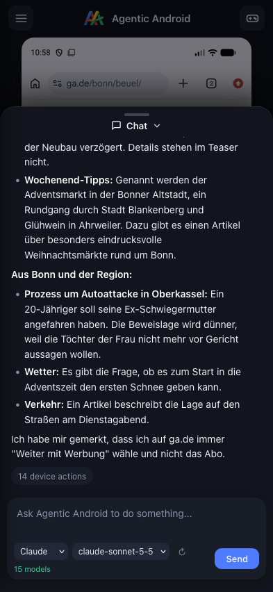
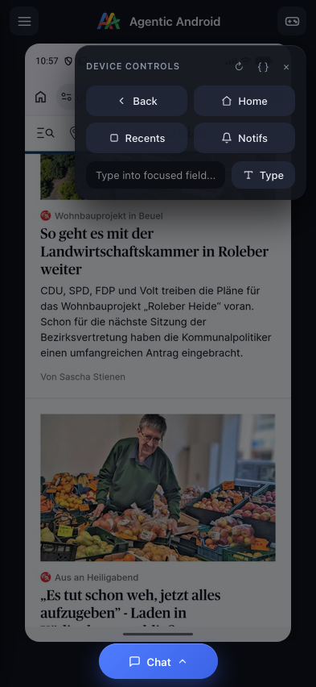
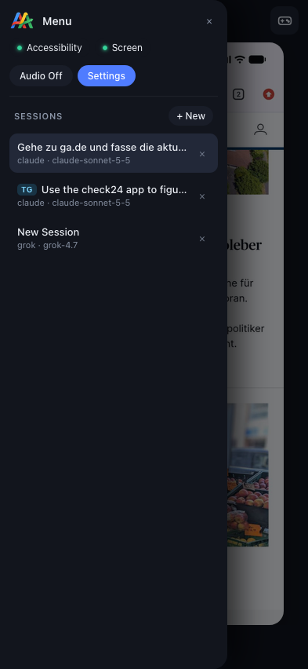
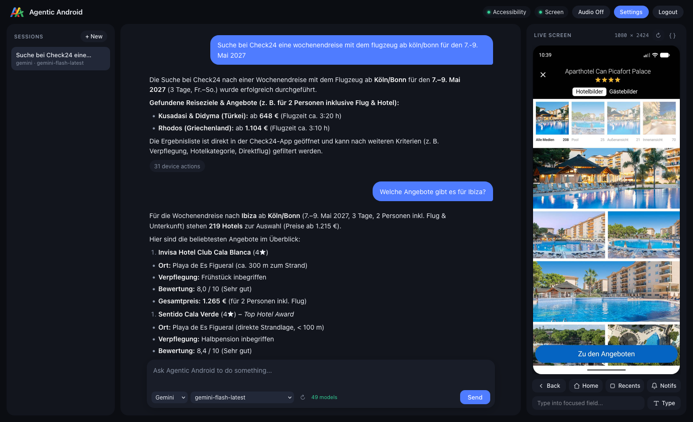

# Agentic Android

[English](README.md) · **Deutsch** · [简体中文](README.zh-CN.md)

<p align="left">
  <a href="https://github.com/jankammerath/AgenticAndroid/releases/latest/download/AgenticAndroid.apk">
    </a>
  <a href="https://github.com/jankammerath/AgenticAndroid/releases/latest/download/agentic-android.deb">
    </a>
  <a href="https://github.com/jankammerath/AgenticAndroid/releases/latest/download/agentic-android.rpm">
    </a>
  <a href="https://github.com/jankammerath/AgenticAndroid/releases">
    </a>
</p>

[](https://github.com/sponsors/jankammerath)

> Die Anwendung in den `rpm`- und `deb`-Paketen kann als CLI und `systemd`-Dienst unter Linux mit dem Android-Emulator statt eines physischen Geräts betrieben werden. Nutze das Skript `install.sh` für eine Ein-Befehl-Installation. Wenn du den Agenten auf einem physischen Android-Gerät ausführen möchtest, installiere einfach die `apk`-Datei.

Agentic Android ist eine in **Rust** entwickelte App mit einem minimalen **Kotlin**-Frontend, die einen eingebetteten Webserver mit moderner Weboberfläche bereitstellt. Sie nutzt die Android-Bedienungshilfen (Accessibility Services), um den Bildschirm zu erfassen und das Gerät zu steuern – inklusive menschenähnlicher Interaktionen wie Tippen, Doppeltippen, langem Drücken, Wischen, Texteingabe, App-Start und Systemnavigation für deinen konfigurierten KI-Agenten.

<table>
   <tr>
      <td>
         
      </td>
      <td>
         
      </td>
      <td>
         
      </td>
      <td>
         
      </td>
   </tr>
</table>

<table>
   <tr>
      <td>
         
      </td>
   </tr>
</table>

## Architektur

- **Kernkomponente (`rust-core`)**: Leistungsstarke NDK-Bibliothek (`libagentic_android.so`) in Rust. Betreibt den Axum-HTTP/WebSocket-Webserver, die eingebettete Web-UI, den Live-Video-/Audio-Streaming-Hub, den Sitzungsspeicher und die Multi-Provider-KI-Agenten-Engine.
- **App-UI (`app`)**: Minimales Kotlin/Android-Frontend zum Konfigurieren sowie Starten/Stoppen des Webserver-Vordergrunddienstes, Aktivieren der Bedienungshilfe und optionalen Starten der High-FPS MediaProjection Bildschirm- & Audio-Übertragung.
- **Web-UI**: Fernsteuerungs-Dashboard mit Multi-Session-Chatbot (mit Live-Modellerkennung für **Claude**, **Gemini**, **Grok** und **OpenAI**) direkt neben einem interaktiven Live-Stream des Gerätebildschirms und -tons.

## APK per Sideload installieren

### Option 1: Direkt auf dem Android-Smartphone installieren

1. **APK herunterladen**: Lade die APK direkt auf dein Android-Gerät über den Button **[Download APK](https://github.com/jankammerath/AgenticAndroid/releases/latest/download/AgenticAndroid.apk)** oben (oder über die [Releases](https://github.com/jankammerath/AgenticAndroid/releases)-Seite).
2. **Unbekannte Quellen zulassen**: Tippe auf die heruntergeladene Datei `AgenticAndroid.apk`. Falls Android nachfragt, tippe auf **Einstellungen**, aktiviere **Aus dieser Quelle zulassen** für deinen Browser oder Dateimanager und tippe auf **Installieren**.
3. **Eingeschränkte Einstellungen zulassen (Android 13+)**: Da Android bei per Sideload installierten Apps Bedienungshilfen standardmäßig sperrt:
   - Öffne Android **Einstellungen → Apps → Alle Apps anzeigen → Agentic Android**.
   - Tippe oben rechts auf das **⋮**-Menü (drei Punkte) und wähle **Eingeschränkte Einstellungen zulassen**.
4. **Bedienungshilfe aktivieren**:
   - Öffne **Agentic Android** und tippe auf **Bedienungshilfe aktivieren** (oder gehe zu **Einstellungen → Bedienungshilfen → Agentic Android Steuerung**).
   - Aktiviere **Agentic Android Steuerung verwenden**.
5. **Webserver starten**:
   - Prüfe in **Agentic Android** den Port (Standard `8080`) und stelle sicher, dass der Server läuft.
   - *(Optional)* Tippe auf **High-FPS Bildschirm- & Audio-Übertragung starten** und bestätige die Bildschirmfreigabe für flüssiges Live-Video und Audio. (Ohne diese Option fällt die App ab Android 11 automatisch auf Bedienungshilfe-Screenshots zurück.)
6. **Web-UI öffnen**:
   - Öffne die in der App angezeigte URL `http://<telefon-ip>:8080` in einem beliebigen Browser im selben WLAN.
   - Klicke auf **Einstellungen**, um einen oder mehrere API-Schlüssel (**Claude**, **Gemini**, **Grok** oder **OpenAI**) einzutragen.
   - Wähle unten im Eingabefeld deinen Anbieter und das live geladene Modell aus und starte den Chat!

### Option 2: Per ADB vom Computer installieren

```bash
# APK installieren
adb install -r AgenticAndroid.apk

# Webserver-Port auf localhost weiterleiten
adb forward tcp:8080 tcp:8080
```

Öffne anschließend `http://localhost:8080` im Browser auf deinem Computer.

## Linux-Server-Installation (Zero-Conf Installer & Upgrader)

### Ein-Befehl-Installation oder Upgrade (Debian/Ubuntu & Fedora/RHEL)

Führe `install.sh` auf einem beliebigen Linux-Server mit `x86_64` oder `arm64` aus (z. B. einer AWS-EC2-Instanz `c8i.xlarge` mit aktivierter verschachtelter Virtualisierung):

```bash
curl -fsSL https://raw.githubusercontent.com/jankammerath/AgenticAndroid/main/install.sh | sudo bash
```

Das Installationsskript ist **zero-conf** und idempotent (erneutes Ausführen aktualisiert auf das neueste Release, ohne Zugangsdaten oder Konfiguration zu überschreiben):
1. Installiert KVM, Java 17 sowie alle Android-Emulator-Laufzeitbibliotheken automatisch.
2. Installiert bzw. aktualisiert das Android SDK, den Emulator und das passende System-Image in `/opt/android-sdk`.
3. Lädt das neueste `.deb`- oder `.rpm`-Paket herunter, installiert/aktualisiert es und startet `agentic-android.service` über `systemd`.
4. Fragt nach **Port** (Standard `8080`) und **Hostname** – wird ein Hostname angegeben, installiert das Skript **Caddy** und richtet automatisch **Let's Encrypt HTTPS** (`https://<hostname>`) samt Erneuerung ein.
5. Richtet bei einer Erstinstallation automatisch einen Standard-**Benutzernamen (`admin`) und ein generiertes Passwort** (ohne 2FA) ein und gibt diese am Ende aus.

Für nicht-interaktive Installationen können Umgebungsvariablen übergeben werden:

```bash
curl -fsSL https://raw.githubusercontent.com/jankammerath/AgenticAndroid/main/install.sh | \
  sudo PORT=8080 HOSTNAME_DOMAIN=android.example.com LETSENCRYPT_EMAIL=you@example.com bash
```

### Manuelle DEB- / RPM-Installation & Abhängigkeiten

Die `.deb`- und `.rpm`-Pakete installieren die Rust-CLI `agentic-android` (`/usr/bin/agentic-android`), die gebündelte Universal-APK (`/usr/share/agentic-android/AgenticAndroid.apk`), eine Standardkonfiguration (`/etc/agentic-android/config.toml`) sowie einen `systemd`-Dienst (`agentic-android.service`), der einen Headless-Android-Emulator im Hintergrund betreibt.

### 1. KVM & Systemabhängigkeiten installieren

Der Android-Emulator benötigt Hardware-Virtualisierung (**KVM**) unter Linux (`x86_64`) sowie einige Laufzeitbibliotheken und Java 17 (für `sdkmanager` / `avdmanager`):

**Debian / Ubuntu:**
```bash
sudo apt-get update
sudo apt-get install -y \
  qemu-system-x86 libvirt-daemon-system bridge-utils cpu-checker \
  openjdk-17-jre-headless unzip curl \
  libpulse0 libgl1 libnss3 libxcomposite1 libxcursor1 libxi6 libxtst6

# Prüfen, ob KVM-Hardware-Virtualisierung verfügbar ist
kvm-ok
```

**Fedora / RHEL / Rocky Linux:**
```bash
sudo dnf install -y \
  qemu-kvm libvirt java-17-openjdk-headless unzip curl \
  pulseaudio-libs mesa-libGL nss libXcomposite libXcursor libXi libXtst

# Prüfen, ob /dev/kvm vorhanden ist
ls -l /dev/kvm
```

### 2. Android SDK, Emulator & System-Image installieren

Installiere die Android-Kommandozeilen-Tools nach `/opt/android-sdk` (Standardpfad für `android_home` in `/etc/agentic-android/config.toml`):

```bash
sudo mkdir -p /opt/android-sdk/cmdline-tools
cd /tmp
curl -fsSL https://dl.google.com/android/repository/commandlinetools-linux-11076708_latest.zip -o cmdline-tools.zip
unzip -q cmdline-tools.zip -d cmdline-tools-tmp
sudo mv cmdline-tools-tmp/cmdline-tools /opt/android-sdk/cmdline-tools/latest
rm -rf cmdline-tools.zip cmdline-tools-tmp

export ANDROID_HOME=/opt/android-sdk
export PATH="$ANDROID_HOME/cmdline-tools/latest/bin:$ANDROID_HOME/platform-tools:$ANDROID_HOME/emulator:$PATH"

# Lizenzen akzeptieren und platform-tools, emulator sowie x86_64 Google Play Store System-Image installieren
yes | sudo "$ANDROID_HOME/cmdline-tools/latest/bin/sdkmanager" --sdk_root="$ANDROID_HOME" --licenses >/dev/null
sudo "$ANDROID_HOME/cmdline-tools/latest/bin/sdkmanager" --sdk_root="$ANDROID_HOME" \
  "platform-tools" \
  "emulator" \
  "platforms;android-35" \
  "system-images;android-35;google_apis_playstore;x86_64"
```

### 3. Agentic-Android-Paket installieren

**Debian / Ubuntu (`.deb`):**
```bash
curl -fsSL https://github.com/jankammerath/AgenticAndroid/releases/latest/download/agentic-android.deb -o agentic-android.deb
sudo apt-get install -y ./agentic-android.deb
```

**Fedora / RHEL / Rocky Linux (`.rpm`):**
```bash
curl -fsSL https://github.com/jankammerath/AgenticAndroid/releases/latest/download/agentic-android.rpm -o agentic-android.rpm
sudo dnf install -y ./agentic-android.rpm
```

### 4. systemd-Dienst konfigurieren & aktivieren

1. *(Optional)* Prüfe `/etc/agentic-android/config.toml`, um AVD-Name, Port (Standard `8080`) oder `android_home` anzupassen. Existiert das konfigurierte AVD noch nicht, erstellt `agentic-android` beim ersten Start automatisch `agentic_android_avd` aus dem installierten `x86_64`-System-Image.
2. Dienst aktivieren und starten:
   ```bash
   sudo systemctl enable --now agentic-android
   ```
3. Dienststatus und Logs prüfen:
   ```bash
   sudo systemctl status agentic-android
   sudo journalctl -u agentic-android -f
   agentic-android daemon status
   ```
4. Öffne `http://<server-ip>:8080` (oder `http://localhost:8080`), füge unter **Einstellungen** deine KI-API-Schlüssel hinzu und aktiviere bei Netzwerkzugriff am besten **Einstellungen → Sicherheit** (Benutzername/Passwort + 2FA).

## Fernsteuerung per Telegram-Bot

Agentic Android enthält einen integrierten Telegram-Bot (über Rust-Long-Polling – keine Portweiterleitung oder Webhooks nötig), sodass du dein Android-Gerät von überall per WLAN oder Mobilfunk steuern kannst.

### Einrichtung

1. **Bot erstellen**: Öffne Telegram, schreibe [@BotFather](https://t.me/BotFather), sende `/newbot` und folge den Anweisungen, um deinen **Bot-Token** (`123456789:AAH...`) zu kopieren.
2. **In Agentic Android verbinden**: Öffne Web-UI → **Einstellungen → Telegram**, füge deinen **Bot-Token** ein, aktiviere **Telegram-Bot aktivieren** und klicke auf **Telegram-Einstellungen speichern**. Das Status-Badge wechselt zu `Connected (@dein_bot)`.
3. **Chat-ID autorisieren**: Öffne deinen neuen Bot in Telegram und sende `/id`. Kopiere die zurückgegebene numerische Chat-ID, trage sie unter **Erlaubte Chat-IDs** in **Einstellungen → Telegram** ein (bei mehreren IDs kommagetrennt) und klicke auf **Telegram-Einstellungen speichern**.
4. **Gerät steuern**: Sende dem Bot eine beliebige Aufgabe in natürlicher Sprache – Antworten sowie aufgenommene/zugeschnittene Screenshots werden direkt in Telegram zurückgesendet und in der Sitzungsliste der Web-UI synchronisiert.

### Bot-Befehle

| Befehl | Beschreibung |
| --- | --- |
| `/id` oder `/start` | Zeigt deine Telegram-Chat-ID und den Autorisierungsstatus an |
| `/status` | Zeigt Gerätename, Status der Bedienungshilfe und Standardanbieter/-modell an |
| `/screenshot` | Erstellt einen Screenshot des aktuellen Android-Bildschirms und sendet ihn als Foto |
| `/new` | Startet eine neue Agenten-Sitzung für diesen Telegram-Chat |
| `/stop` | Stoppt die aktuell laufende Agenten-Aufgabe |

## Entwicklung & Ausführung im Android-Emulator

### Voraussetzungen

- **Rust** (`rustup`) mit Android-Targets (z. B. `aarch64-linux-android` auf Apple Silicon oder `x86_64-linux-android` auf x86_64)
- **Android SDK & NDK** (NDK `27.x`)
- **JDK 17+** (oder die mit Android Studio gebündelte JBR)

### Rust-CLI & Headless-Daemon (`cli/`)

Agentic Android enthält eine Rust-CLI (`agentic-android`, gekapselt über `./launch.sh`), die aus dem Quellcode baut oder eine fertige APK installiert, einen Android-Emulator (GUI oder Headless) startet, Berechtigungen erteilt, die Bedienungshilfe aktiviert, den Port weiterleitet und als überwachter Hintergrund-Daemon unter macOS oder Linux laufen kann:

```bash
# Rust-CLI bauen (oder ./launch.sh ausführen, das sie automatisch baut)
cargo build --release --manifest-path cli/Cargo.toml

# Aus Quellcode bauen und im Emulator starten
./launch.sh --avd Pixel_9a --port 8080

# Laufenden Emulator beenden (und aktiven Daemon stoppen)
./launch.sh stop

# Vorgefertigte APK statt Quellcode-Build installieren
./launch.sh --apk AgenticAndroid.apk --avd Pixel_9a

# Headless als Hintergrund-Supervisor-Daemon starten (ideal für Linux-Server)
./launch.sh daemon start --headless --avd Pixel_9a --apk AgenticAndroid.apk --port 8080
./launch.sh daemon status
./launch.sh daemon stop

# Linux-systemd-Service-Unit für den Headless-Betrieb erzeugen
./launch.sh daemon systemd --avd Pixel_9a --apk /opt/agentic/AgenticAndroid.apk --port 8080

# Verfügbare AVDs auflisten
./launch.sh avds

# GPS-Koordinaten eines laufenden Emulators im Betrieb aktualisieren
./launch.sh geo --lat 50.7374 --lon 7.0982
```

Standardwerte lassen sich auch in `~/.agentic-android/config.toml` oder `/etc/agentic-android/config.toml` speichern (oder per `--config <pfad>` übergeben):

```toml
avd = "Pixel_9a"
apk = "/opt/agentic/AgenticAndroid.apk"
port = 8080
headless = true
android_home = "/opt/android-sdk"
latitude = 50.7374
longitude = 7.0982
# altitude = 60.0
# frida = true                      # frida-server + konfigurierte Skripte standardmäßig starten
# frida_bin = "/usr/local/bin/frida" # Host-frida-CLI (Standard: automatisch über PATH erkennen)
# frida_server = "/opt/frida/frida-server-android-x86_64"  # optional; sonst automatischer Download
```

Sobald der Dienst läuft, öffne **http://localhost:8080** im Browser.

### Frida-Instrumentierung (Emulator)

Wenn der Dienst über den Supervisor (`run` / `daemon` / `systemd`) läuft, öffne **Einstellungen → Emulator → Frida-Instrumentierung** in der Web-UI, um:

- **Frida ein-/auszuschalten.** Bei Aktivierung schaltet der Supervisor den Emulator in den Root-Modus (`adb root`, mit Fallback auf `su`), lädt das zur Host-Version (`frida --version`) und Emulator-ABI passende `frida-server`-Binary herunter (zwischengespeichert in `<state_dir>/frida/server/`), überträgt es nach `/data/local/tmp/frida-server` und startet es. Beim Deaktivieren werden alle Skripte sowie `frida-server` gestoppt.
- **Skripte festzulegen.** Jedes Skript besitzt ein Ziel-App-Paket, einen Modus (*Anhängen* an die laufende App via `frida -N` oder *Starten* der App mit dem Skript via `frida -f`), einen Ein-/Aus-Schalter sowie den JavaScript-Quelltext (einfügen oder `.js`-Datei importieren). Die Logs lassen sich pro Skript direkt in der Web-UI einsehen.

Die Einstellungen werden in `<state_dir>/frida/settings.json` gespeichert und nach jedem Emulator-(Neu-)Start automatisch erneut angewendet; Skripte im Attach-Modus verbinden sich automatisch neu, wenn die Ziel-App neu startet. Voraussetzungen: `pip install frida-tools` auf dem Host, `curl` + `xz` für den automatischen Download sowie ein rootbares System-Image (`google_apis` / `default`, nicht `google_apis_playstore`). Der Konfigurationsschlüssel `frida` bzw. das Flag `--frida` legt nur den Anfangswert fest – sobald die Einstellung in der Web-UI gespeichert wurde, hat diese Vorrang.

## Neue Version veröffentlichen

Das Pushen eines Versions-Tags löst `.github/workflows/release.yml` aus: Der Rust-Kern wird für `arm64-v8a`, `armeabi-v7a` und `x86_64` kompiliert, eine signierte Universal-APK gebaut und als GitHub-Release veröffentlicht:

```bash
git tag v0.1.0
git push origin v0.1.0
```

Ein Release kann auch manuell über den Workflow-Tab **Actions → Build & Release APK** gestartet werden.

### Optionale persistente Signierungs-Secrets

Um Release-APKs mit deinem eigenen Keystore zu signieren (empfohlen, damit Nutzer ohne Neuinstallation direkt aktualisieren können), hinterlege diese Repository-Secrets unter **GitHub → Settings → Secrets and variables → Actions**:

- `ANDROID_KEYSTORE_BASE64`: Base64-kodierte `.jks`- / `.keystore`-Datei (`base64 -i release.keystore`)
- `ANDROID_KEYSTORE_PASSWORD`: Keystore-Passwort
- `ANDROID_KEY_ALIAS`: Schlüssel-Alias
- `ANDROID_KEY_PASSWORD`: Schlüssel-Passwort

Sind diese Secrets nicht gesetzt, erzeugt der Workflow automatisch einen Ad-hoc-Signaturschlüssel, sodass die veröffentlichte APK dennoch sofort per Sideload installiert werden kann.
