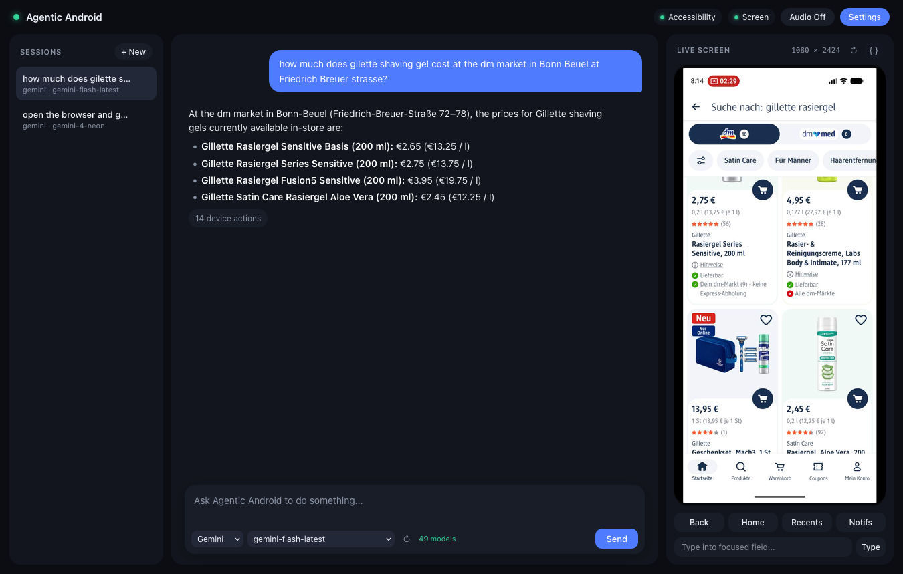

# Agentic Android

<p align="left">
  <a href="https://github.com/jankammerath/AgenticAndroid/releases/latest/download/AgenticAndroid.apk">
    </a>
  <a href="https://github.com/jankammerath/AgenticAndroid/releases">
    </a>
</p>

[](https://github.com/sponsors/jankammerath)

Agentic Android is an app built in **Rust** with a minimal **Kotlin** app frontend, serving an embedded webserver with a modern web interface. It uses Android's Accessibility Services to observe and control the phone, exposing human-like interactions — tap, double tap, long press, swipe, text input, app launching, and system navigation — to your configured AI agent.



## Architecture

- **Core Component (`rust-core`)**: High-performance NDK library (`libagentic_android.so`) written in Rust. Runs the Axum HTTP/WebSocket webserver, embedded Web UI, live video/audio streaming hub, session storage, and multi-provider AI agent engine.
- **App UI (`app`)**: Minimal Kotlin/Android frontend whose only role is configuring and starting/stopping the background webserver foreground service, enabling Accessibility Services, and optionally starting high-FPS MediaProjection screen & audio capture.
- **Web UI**: Remote control dashboard combining a multi-session chatbot (with live model discovery for **Claude**, **Gemini**, **Grok**, and **OpenAI**) alongside a live interactive stream of the device screen and audio.

---

## How to Sideload the APK

### Option 1: Install directly on your Android phone

1. **Download the APK** on your Android device using the **[Download APK](https://github.com/jankammerath/AgenticAndroid/releases/latest/download/AgenticAndroid.apk)** button above (or from the [Releases](https://github.com/jankammerath/AgenticAndroid/releases) page).
2. **Allow unknown sources**: Tap the downloaded `AgenticAndroid.apk` file. If Android prompts you, tap **Settings** and enable **Allow from this source** for your browser or file manager, then tap **Install**.
3. **Allow Restricted Settings (Android 13+)**: Because Android restricts sideloaded apps from enabling Accessibility Services by default:
   - Open Android **Settings → Apps → See all apps → Agentic Android**.
   - Tap the **⋮** (three dots) menu in the top-right corner and select **Allow restricted settings**.
4. **Enable Accessibility Control**:
   - Open **Agentic Android** and tap **Enable Accessibility Service** (or go to **Settings → Accessibility → Agentic Android Control**).
   - Toggle **Use Agentic Android Control** on.
5. **Start the Webserver**:
   - In **Agentic Android**, verify the port (default `8080`) and ensure the server is running.
   - *(Optional)* Tap **Start High-FPS Screen & Audio Cast** and approve screen capture for smooth live video and audio streaming. (Without this, the app automatically falls back to Accessibility screenshots on Android 11+.)
6. **Open the Web UI**:
   - Open the `http://<phone-ip>:8080` URL shown in the app from any browser on the same Wi-Fi network.
   - Click **Settings** to enter one or more API keys (**Claude**, **Gemini**, **Grok**, or **OpenAI**).
   - Pick your provider and live-fetched model at the bottom of the prompt box and start chatting!

### Option 2: Sideload via ADB from a computer

```bash
# Install the APK
adb install -r AgenticAndroid.apk

# Forward the webserver port to localhost
adb forward tcp:8080 tcp:8080
```

Then open `http://localhost:8080` in your computer's browser.

---

## Development & Running in the Android Emulator

### Prerequisites

- **Rust** (`rustup`) with Android targets (e.g. `aarch64-linux-android` on Apple Silicon or `x86_64-linux-android` on x86_64)
- **Android SDK & NDK** (NDK `27.x`)
- **JDK 17+** (or Android Studio's bundled JBR)

### Launch Script

The included `launch.sh` builds the Rust NDK library, compiles the Android APK, boots an emulator, installs the app, enables the Accessibility Service automatically, and forwards port `8080`:

```bash
# Launch using the default phone AVD
./launch.sh

# Specify a particular AVD and/or port
./launch.sh --avd Pixel_9a --port 8080

# Build only without launching an emulator
./launch.sh --build-only
```

Once running, open **http://localhost:8080** in your browser.

---

## Releasing a New Version

Pushing a version tag triggers `.github/workflows/release.yml`, which compiles the Rust core for `arm64-v8a`, `armeabi-v7a`, and `x86_64`, builds a signed universal APK, and publishes a GitHub Release:

```bash
git tag v0.1.0
git push origin v0.1.0
```

You can also trigger a release manually from the **Actions → Build & Release APK** workflow tab.

### Optional Persistent Signing Secrets

To sign release APKs with your own keystore (recommended so users can upgrade in-place without reinstalling), add these repository secrets in **GitHub → Settings → Secrets and variables → Actions**:

- `ANDROID_KEYSTORE_BASE64`: Base64-encoded `.jks` / `.keystore` file (`base64 -i release.keystore`)
- `ANDROID_KEYSTORE_PASSWORD`: Keystore password
- `ANDROID_KEY_ALIAS`: Key alias
- `ANDROID_KEY_PASSWORD`: Key password

If these secrets are not set, the workflow automatically generates an ad-hoc signing key so the published APK is still immediately sideloadable.
