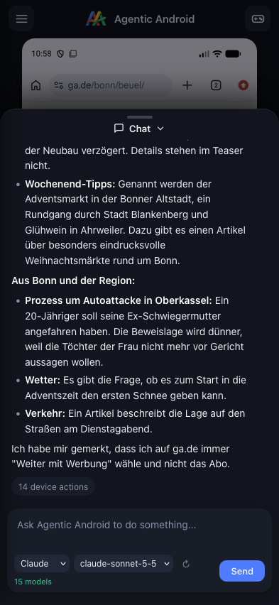
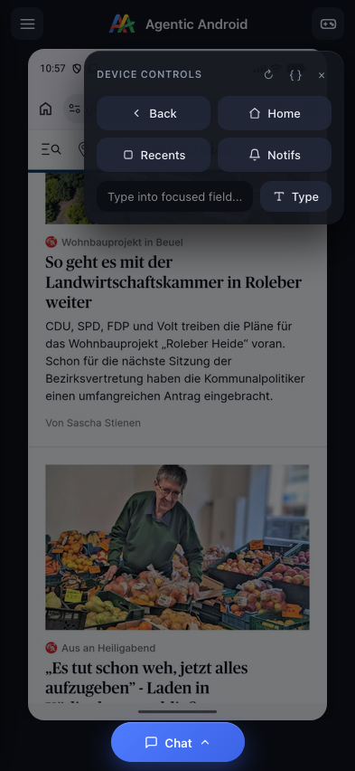
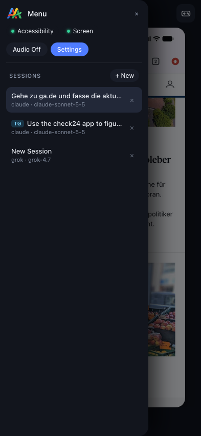
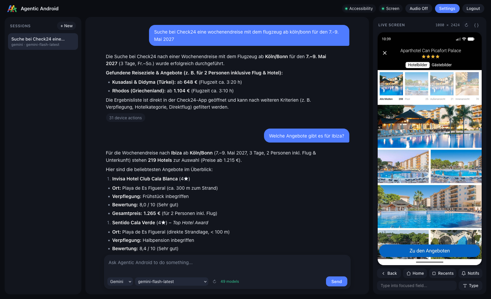

# Agentic Android

[English](README.md) · [Deutsch](README.de.md) · **简体中文**

<p align="left">
  <a href="https://github.com/jankammerath/AgenticAndroid/releases/latest/download/AgenticAndroid.apk">
    </a>
  <a href="https://github.com/jankammerath/AgenticAndroid/releases/latest/download/agentic-android.deb">
    </a>
  <a href="https://github.com/jankammerath/AgenticAndroid/releases/latest/download/agentic-android.rpm">
    </a>
  <a href="https://github.com/jankammerath/AgenticAndroid/releases">
    </a>
</p>

[](https://github.com/sponsors/jankammerath)

> `rpm` 和 `deb` 安装包中的程序可以作为命令行工具和 `systemd` 服务运行在 Linux 服务器上，使用 Android 模拟器替代实体手机。可使用 `install.sh` 脚本一键安装。如果你希望在实体 Android 手机上运行代理，直接安装 `apk` 文件即可。

Agentic Android 是一款以 **Rust** 为核心、搭配极简 **Kotlin** 前端的应用，内置 Web 服务器和现代化的 Web 控制界面。它通过 Android 无障碍服务（Accessibility Services）观察并控制手机，向你配置的 AI 代理提供接近真人的交互能力——包括点击、双击、长按、滑动、文本输入、启动应用以及系统导航。

<table>
   <tr>
      <td>
         
      </td>
      <td>
         
      </td>
      <td>
         
      </td>
      <td>
         
      </td>
   </tr>
</table>

<table>
   <tr>
      <td>
         
      </td>
   </tr>
</table>

## 架构说明

- **核心组件（`rust-core`）**：采用 Rust 编写的高性能 NDK 动态库（`libagentic_android.so`），负责运行 Axum HTTP/WebSocket 服务器、内嵌 Web 界面、实时音视频推流中心、会话存储以及多模型 AI 代理引擎。
- **应用界面（`app`）**：极简 Kotlin/Android 前端，仅负责配置与启停后台 Web 服务器前台服务、启用无障碍服务，以及按需开启高帧率 MediaProjection 画面与音频推流。
- **Web 界面**：远程控制面板，集成多会话聊天机器人（支持 **Claude**、**Gemini**、**Grok** 和 **OpenAI** 的实时模型拉取）以及可交互的设备实时画面与音频流。

## 如何侧载安装 APK

### 方式一：直接在 Android 手机上安装

1. **下载 APK**：在 Android 设备上点击上方的 **[Download APK](https://github.com/jankammerath/AgenticAndroid/releases/latest/download/AgenticAndroid.apk)** 按钮（或前往 [Releases](https://github.com/jankammerath/AgenticAndroid/releases) 页面）下载。
2. **允许未知来源安装**：点击已下载的 `AgenticAndroid.apk`。如果系统提示，点击**设置**并为浏览器或文件管理器开启**允许来自此来源的应用**，然后点击**安装**。
3. **允许受限设置（Android 13+）**：由于 Android 默认禁止侧载应用直接开启无障碍服务：
   - 打开 Android **设置 → 应用 → 查看全部应用 → Agentic Android**。
   - 点击右上角 **⋮**（三个点）菜单，选择**允许受限设置**。
4. **启用无障碍控制**：
   - 打开 **Agentic Android** 并点击**启用无障碍服务**（或前往 **设置 → 无障碍 → Agentic Android 控制**）。
   - 开启**使用 Agentic Android 控制**开关。
5. **启动 Web 服务器**：
   - 在 **Agentic Android** 中确认端口（默认 `8080`）并确保服务器处于运行状态。
   - *（可选）* 点击**开启高帧率画面与音频推流**并同意屏幕共享权限，即可获得流畅的实时音视频流。（未开启时，Android 11+ 会自动回退为无障碍截图模式。）
6. **打开 Web 界面**：
   - 在同一 Wi-Fi 网络下的任意浏览器中访问应用内显示的 `http://<手机IP>:8080`。
   - 点击**设置**填入一个或多个 API 密钥（**Claude**、**Gemini**、**Grok** 或 **OpenAI**）。
   - 在输入框底部选择服务商和实时获取的模型，即可开始对话！

### 方式二：通过电脑使用 ADB 安装

```bash
# 安装 APK
adb install -r AgenticAndroid.apk

# 将 Web 服务器端口转发到本地
adb forward tcp:8080 tcp:8080
```

然后在电脑浏览器中打开 `http://localhost:8080`。

## Linux 服务器安装（零配置一键安装与升级）

### 一键安装或升级（Debian/Ubuntu 与 Fedora/RHEL）

在任意 Linux `x86_64` 或 `arm64` 服务器上运行 `install.sh`（例如开启嵌套虚拟化的 AWS EC2 `c8i.xlarge`）：

```bash
curl -fsSL https://raw.githubusercontent.com/jankammerath/AgenticAndroid/main/install.sh | sudo bash
```

该安装脚本**零配置且幂等**（重复运行可平滑升级到最新版本，不会覆盖你的凭据或配置）：
1. 自动安装 KVM、Java 17 以及 Android 模拟器所需的全部运行库。
2. 在 `/opt/android-sdk` 中自动安装/更新 Android SDK、模拟器和对应系统镜像。
3. 下载并安装/升级最新的 `.deb` 或 `.rpm` 包，并通过 `systemd` 启动 `agentic-android.service`。
4. 提示输入**端口**（默认 `8080`）和**域名**——如果提供了域名，将自动安装 **Caddy** 并签发及续期 **Let's Encrypt HTTPS** 证书（`https://<hostname>`）。
5. 首次安装时会自动配置默认**用户名（`admin`）和随机生成的密码**（默认不开启 2FA），并在结束时打印。

如需非交互式安装，可直接传入环境变量：

```bash
curl -fsSL https://raw.githubusercontent.com/jankammerath/AgenticAndroid/main/install.sh | \
  sudo PORT=8080 HOSTNAME_DOMAIN=android.example.com LETSENCRYPT_EMAIL=you@example.com bash
```

### 手动安装 DEB / RPM 及依赖

`.deb` 和 `.rpm` 包会安装 Rust 命令行工具 `agentic-android`（`/usr/bin/agentic-android`）、内置通用 APK（`/usr/share/agentic-android/AgenticAndroid.apk`）、默认配置文件（`/etc/agentic-android/config.toml`）以及用于在后台运行无头 Android 模拟器的 `systemd` 服务（`agentic-android.service`）。

### 1. 安装 KVM 与系统依赖

Android 模拟器在 Linux（`x86_64`）上需要硬件虚拟化（**KVM**）、部分运行库以及 Java 17（供 `sdkmanager` / `avdmanager` 使用）：

**Debian / Ubuntu：**
```bash
sudo apt-get update
sudo apt-get install -y \
  qemu-system-x86 libvirt-daemon-system bridge-utils cpu-checker \
  openjdk-17-jre-headless unzip curl \
  libpulse0 libgl1 libnss3 libxcomposite1 libxcursor1 libxi6 libxtst6

# 检查 KVM 硬件虚拟化是否可用
kvm-ok
```

**Fedora / RHEL / Rocky Linux：**
```bash
sudo dnf install -y \
  qemu-kvm libvirt java-17-openjdk-headless unzip curl \
  pulseaudio-libs mesa-libGL nss libXcomposite libXcursor libXi libXtst

# 检查 /dev/kvm 是否存在
ls -l /dev/kvm
```

### 2. 安装 Android SDK、模拟器与系统镜像

将 Android 命令行工具安装到 `/opt/android-sdk`（`/etc/agentic-android/config.toml` 中 `android_home` 的默认路径）：

```bash
sudo mkdir -p /opt/android-sdk/cmdline-tools
cd /tmp
curl -fsSL https://dl.google.com/android/repository/commandlinetools-linux-11076708_latest.zip -o cmdline-tools.zip
unzip -q cmdline-tools.zip -d cmdline-tools-tmp
sudo mv cmdline-tools-tmp/cmdline-tools /opt/android-sdk/cmdline-tools/latest
rm -rf cmdline-tools.zip cmdline-tools-tmp

export ANDROID_HOME=/opt/android-sdk
export PATH="$ANDROID_HOME/cmdline-tools/latest/bin:$ANDROID_HOME/platform-tools:$ANDROID_HOME/emulator:$PATH"

# 接受许可并安装 platform-tools、emulator 和 x86_64 Google Play Store 系统镜像
yes | sudo "$ANDROID_HOME/cmdline-tools/latest/bin/sdkmanager" --sdk_root="$ANDROID_HOME" --licenses >/dev/null
sudo "$ANDROID_HOME/cmdline-tools/latest/bin/sdkmanager" --sdk_root="$ANDROID_HOME" \
  "platform-tools" \
  "emulator" \
  "platforms;android-35" \
  "system-images;android-35;google_apis_playstore;x86_64"
```

### 3. 安装 Agentic Android 软件包

**Debian / Ubuntu（`.deb`）：**
```bash
curl -fsSL https://github.com/jankammerath/AgenticAndroid/releases/latest/download/agentic-android.deb -o agentic-android.deb
sudo apt-get install -y ./agentic-android.deb
```

**Fedora / RHEL / Rocky Linux（`.rpm`）：**
```bash
curl -fsSL https://github.com/jankammerath/AgenticAndroid/releases/latest/download/agentic-android.rpm -o agentic-android.rpm
sudo dnf install -y ./agentic-android.rpm
```

### 4. 配置并启用 systemd 服务

1. *（可选）* 检查 `/etc/agentic-android/config.toml`，按需修改 AVD 名称、端口（默认 `8080`）或 `android_home`。如果指定的 AVD 尚未创建，`agentic-android` 会在首次启动时自动基于已安装的 `x86_64` 系统镜像创建 `agentic_android_avd`。
2. 启用并启动服务：
   ```bash
   sudo systemctl enable --now agentic-android
   ```
3. 查看服务状态与日志：
   ```bash
   sudo systemctl status agentic-android
   sudo journalctl -u agentic-android -f
   agentic-android daemon status
   ```
4. 打开 `http://<server-ip>:8080`（或 `http://localhost:8080`），在**设置**中添加 AI 服务商密钥；如果服务暴露在网络中，建议开启**设置 → 安全**（用户名/密码 + 2FA）。

## Telegram 机器人远程控制

Agentic Android 内置 Telegram 机器人（基于 Rust 长轮询实现，无需端口转发或 Webhook），让你可以通过 Wi-Fi 或移动网络随时随地控制 Android 设备。

### 配置步骤

1. **创建机器人**：打开 Telegram，联系 [@BotFather](https://t.me/BotFather)，发送 `/newbot` 并按提示操作，复制你的 **Bot Token**（`123456789:AAH...`）。
2. **在 Agentic Android 中连接**：打开 Web 界面 → **设置 → Telegram**，粘贴 **Bot Token**，勾选**启用 Telegram 机器人**，然后点击**保存 Telegram 设置**。状态徽章将变为 `Connected (@your_bot)`。
3. **授权你的 Chat ID**：在 Telegram 中向你的新机器人发送 `/id`。复制回复的数字 Chat ID，粘贴到**设置 → Telegram** 的**允许的 Chat ID** 中（多个 ID 用逗号分隔），点击**保存 Telegram 设置**。
4. **开始控制手机**：直接向机器人发送自然语言指令——回复和截取/裁剪的屏幕图片会直接发回 Telegram，同时对话也会同步显示在 Web 界面的会话列表中。

### 机器人命令

| 命令 | 说明 |
| --- | --- |
| `/id` 或 `/start` | 显示你的 Telegram Chat ID 及授权状态 |
| `/status` | 显示设备名称、无障碍服务状态及默认服务商/模型 |
| `/screenshot` | 截取当前 Android 屏幕并以图片形式发送 |
| `/new` | 为当前 Telegram 对话开启一个新的代理会话 |
| `/stop` | 停止当前正在运行的代理任务 |

## 开发与在 Android 模拟器中运行

### 环境要求

- **Rust**（`rustup`）及 Android 编译目标（例如 Apple Silicon 上的 `aarch64-linux-android` 或 x86_64 上的 `x86_64-linux-android`）
- **Android SDK & NDK**（NDK `27.x`）
- **JDK 17+**（或 Android Studio 内置的 JBR）

### Rust CLI 与无头守护进程（`cli/`）

Agentic Android 提供 Rust CLI（`agentic-android`，由 `./launch.sh` 封装），支持从源码构建或安装预编译 APK、启动 Android 模拟器（带界面或无头模式）、自动授予权限、启用无障碍服务、转发端口，并可在 macOS 或 Linux 上作为后台守护进程运行：

```bash
# 构建 Rust CLI（或直接运行 ./launch.sh 自动构建）
cargo build --release --manifest-path cli/Cargo.toml

# 从源码构建并在模拟器中启动
./launch.sh --avd Pixel_9a --port 8080

# 终止正在运行的模拟器（并停止守护进程）
./launch.sh stop

# 安装预编译 APK 而不从源码构建
./launch.sh --apk AgenticAndroid.apk --avd Pixel_9a

# 以无头后台守护进程模式运行（适合 Linux 服务器）
./launch.sh daemon start --headless --avd Pixel_9a --apk AgenticAndroid.apk --port 8080
./launch.sh daemon status
./launch.sh daemon stop

# 生成用于无头运行的 Linux systemd 服务单元文件
./launch.sh daemon systemd --avd Pixel_9a --apk /opt/agentic/AgenticAndroid.apk --port 8080

# 列出可用的 AVD
./launch.sh avds

# 动态更新运行中模拟器的 GPS 坐标
./launch.sh geo --lat 50.7374 --lon 7.0982
```

你也可以在 `~/.agentic-android/config.toml` 或 `/etc/agentic-android/config.toml` 中保存默认配置（或通过 `--config <路径>` 指定）：

```toml
avd = "Pixel_9a"
apk = "/opt/agentic/AgenticAndroid.apk"
port = 8080
headless = true
android_home = "/opt/android-sdk"
latitude = 50.7374
longitude = 7.0982
# altitude = 60.0
# frida = true                      # 默认启动 frida-server 及已配置的脚本
# frida_bin = "/usr/local/bin/frida" # 宿主机 frida CLI（默认从 PATH 自动检测）
# frida_server = "/opt/frida/frida-server-android-x86_64"  # 可选；未设置时自动下载
```

运行后在浏览器中打开 **http://localhost:8080**。

### Frida 插桩调试（模拟器）

在通过守护进程（`run` / `daemon` / `systemd`）运行时，可在 Web 界面中打开 **设置 → 模拟器 → Frida 插桩**：

- **开启 / 关闭 Frida。** 启用后，守护进程会将模拟器切换为 root 模式（`adb root`，失败时回退到 `su`），自动下载与宿主机 `frida --version` 及模拟器 ABI 匹配的 `frida-server`（缓存于 `<state_dir>/frida/server/`），推送到 `/data/local/tmp/frida-server` 并启动。关闭后会停止所有脚本及 `frida-server`。
- **管理要加载的脚本。** 每个脚本可配置目标应用包名、模式（通过 `frida -N` *附加*到运行中的应用，或通过 `frida -f` 带脚本*启动*应用）、启用开关以及 JavaScript 源码（可直接粘贴或导入 `.js` 文件），并支持在界面中按脚本查看日志。

配置会持久化保存在 `<state_dir>/frida/settings.json`，每次模拟器启动或重启后都会自动重新应用；附加模式的脚本会在目标应用重启后自动重新附加。环境要求：宿主机安装 `pip install frida-tools`，具备 `curl` + `xz` 用于自动下载，以及可 root 的系统镜像（`google_apis` / `default`，而非 `google_apis_playstore`）。配置文件中的 `frida` 项或 `--frida` 参数仅作为初始默认值；在 Web 界面保存后，以界面设置为准。

## 发布新版本

推送版本标签会触发 `.github/workflows/release.yml`，自动为 `arm64-v8a`、`armeabi-v7a` 和 `x86_64` 编译 Rust 核心、构建已签名的通用 APK 并发布 GitHub Release：

```bash
git tag v0.1.0
git push origin v0.1.0
```

你也可以在 **Actions → Build & Release APK** 工作流页面手动触发发布。

### 可选的持久化签名密钥

如需使用自己的 keystore 对发布版 APK 签名（推荐，方便用户无需卸载即可覆盖升级），请在 **GitHub → Settings → Secrets and variables → Actions** 中添加以下 Secrets：

- `ANDROID_KEYSTORE_BASE64`：Base64 编码的 `.jks` / `.keystore` 文件（`base64 -i release.keystore`）
- `ANDROID_KEYSTORE_PASSWORD`：Keystore 密码
- `ANDROID_KEY_ALIAS`：密钥别名
- `ANDROID_KEY_PASSWORD`：密钥密码

如未设置这些 Secrets，工作流会自动生成临时签名密钥，确保发布的 APK 仍可直接侧载安装。
